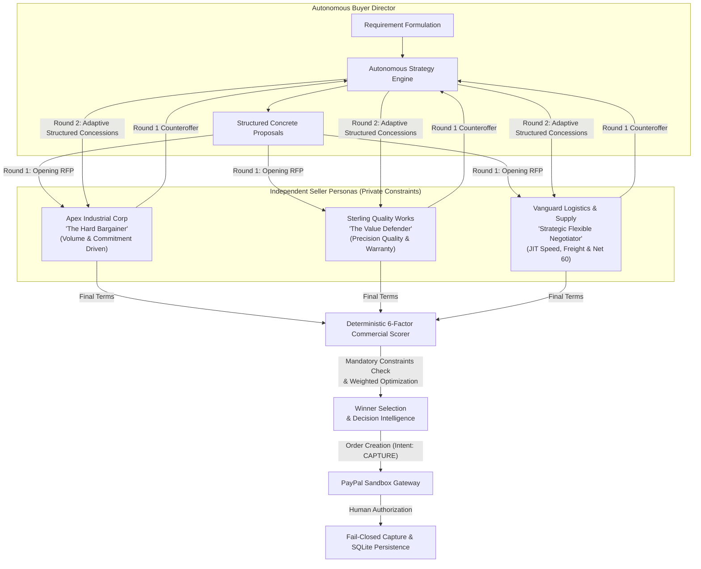
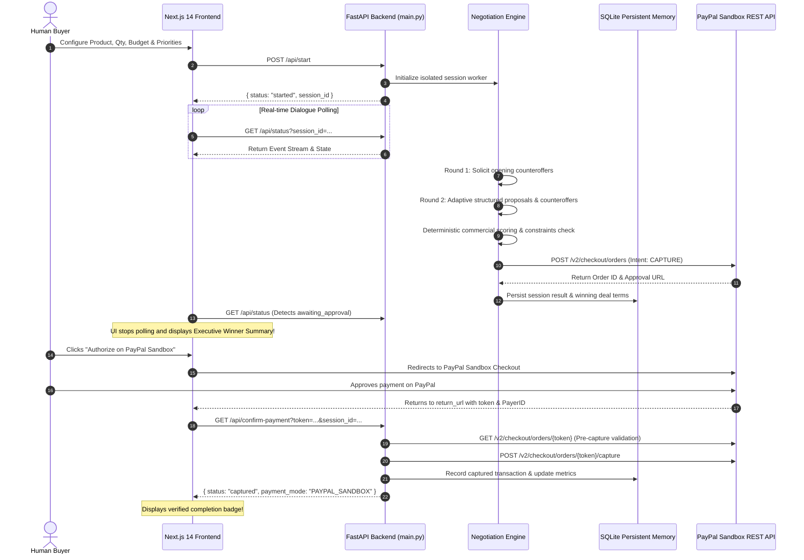

# Autonomous Multi-Agent B2B Procurement System

> **PayPal AI Hackathon Submission**  
> **Live Frontend Preview:** [https://b2b-agents-secondary-frontend.onrender.com](https://b2b-agents-secondary-frontend.onrender.com)  
> **Live Backend API:** [https://b2b-agents-secondary-branch.onrender.com](https://b2b-agents-secondary-branch.onrender.com)  
> **Target Branch:** `feature/autonomous-procurement-upgrade`

---

## 1. Executive Summary & Problem Statement

Traditional enterprise procurement suffers from severe friction:
1. **Manual B2B RFQs take days or weeks**, delaying production timelines and burdening procurement teams with repetitive back-and-forth price negotiations.
2. **One-Dimensional Price Bargaining**: Most buyers fixate solely on unit price, ignoring crucial commercial levers such as delivery lead times, warranty duration, freight absorption, and payment terms (e.g., Net 60 cash-flow optimization).
3. **Fragile Automation & Bot Vulnerabilities**: Simple bots either fold instantly to seller opening quotes or enter endless confrontation without adapting strategy. Furthermore, automated checkout flows often lack fail-closed security and human authorization gates.

The **Autonomous Multi-Agent B2B Procurement System** solves this by deploying an autonomous AI Buyer Director that negotiates multi-variable commercial contracts simultaneously across three independent seller agents, dynamically pivots strategies when price walls are encountered, evaluates trade-offs through deterministic scoring and mandatory constraints, and seamlessly settles agreements through human-authorized PayPal Sandbox checkout.

---

## 2. Core Differentiator: 4 Independent Agents, 3 Divergent Personas

Unlike scripted chat interfaces or monolithic LLM prompts that simulate both sides of a conversation, our platform orchestrates **four genuinely independent agents**, each possessing private constraints, distinct commercial goals, and independent psychological profiles:



### The 3 Seller Personas

1. **Apex Industrial Corp (`The Hard Bargainer`)**:
   * **Psychology**: Volume and commitment driven. Protects margins tenaciously and rarely accepts opening bids.
   * **Bargaining Behavior**: Genuinely resists price cuts on standard orders. Only unlocks deep scale rebates ($72-$75/unit) when the buyer commits to high volume (`qty >= 200`) or explicit multi-order commitments.
   * **Operational Profile**: Rigid 10-day fabrication lead time, standard 12-month warranty, and industrial bulk freight ($90-$120).
   * **Winning Scenario**: Wins on **Lowest Price** and large volume orders where delivery deadlines and warranty extensions are secondary.

2. **Sterling Quality Works (`The Value Defender`)**:
   * **Psychology**: Margin and engineering quality protection. Prides itself on precision engineering, tight tolerances, and ISO 9001 certifications.
   * **Bargaining Behavior**: Strongly resists direct unit price cuts, arguing that cheap components result in catastrophic long-term failure. Instead of slashing unit prices, Sterling aggressively concedes non-price engineering value.
   * **Operational Profile**: Comprehensive 24-to-36 month warranties, dedicated QA certifications, and 100% free white-glove freight shipping ($0 freight).
   * **Winning Scenario**: Wins decisively on **Quality & Warranty** priority or when buyers enforce strict mandatory warranty constraints (`min_warranty_months >= 18`).

3. **Vanguard Logistics & Supply (`The Strategic Flexible Negotiator`)**:
   * **Psychology**: Capacity, velocity, and flexibility driven. Calculating and pragmatic dealmaker looking for win-win operational trades.
   * **Bargaining Behavior**: If the buyer cannot accept high prices, Vanguard trades on delivery lead times, absorption of shipping costs, and favorable cashflow terms (Net 60).
   * **Operational Profile**: Ultra-fast 4-day dispatch, free standard logistics ($0 shipping), and Net 60 commercial payment terms.
   * **Winning Scenario**: Wins decisively on **Fastest Delivery** priority or when buyers enforce strict delivery constraints (`max_delivery_days <= 7`).

---

## 3. Adaptive Negotiation Centerpiece

The Buyer Agent evaluates the numerical positions of all three sellers after Round 1 and **autonomously pivots strategies**:
* **Aggressive Price Discounting (`PRICE_DISCOUNT`)**: Deployed when sellers exhibit price flexibility (>12% discount below budget cap) or when the buyer's explicit priority is Lowest Price.
* **Non-Price Commercial Pivot (`WARRANTY_EXPANSION_AND_FREIGHT_CONCESSION`)**: Triggered autonomously when sellers resist price cuts (<12% discount). Instead of wasting rounds repeatedly asking for discounts, the buyer pivots to extract non-price value: extended warranties (24+ months), waived freight ($0), and extended payment terms (Net 60).
* **Expedited Logistics Acceleration (`EXPEDITED_DELIVERY_AND_TERMS`)**: Deployed when the buyer's priority is rapid delivery or tight lead times, targeting priority queue dispatch and freight absorption.

---

## 4. Multi-Factor Commercial Scoring & Mandatory Constraints

Offers are scored deterministically across **6 weighted factors**:

$$\text{Total Score} = S_{\text{Price}} + S_{\text{Delivery}} + S_{\text{Warranty}} + S_{\text{Shipping}} + S_{\text{PaymentTerms}} + S_{\text{Reliability}}$$

| Dimension | Default Balanced Weight | Lowest Price Focus | Fastest Delivery Focus | Quality & Warranty Focus |
| :--- | :---: | :---: | :---: | :---: |
| **Price Competitiveness** | 40% | 50% | 30% | 25% |
| **Delivery Lead Time** | 15% | 10% | 35% | 10% |
| **Warranty Duration** | 15% | 10% | 15% | 35% |
| **Shipping Freight Cost** | 10% | 10% | 10% | 5% |
| **Payment Terms (Net 60 vs Net 30)** | 10% | 10% | 5% | 10% |
| **Supplier Reliability History** | 10% | 10% | 5% | 15% |

### Mandatory Disqualification Rules (Hard Constraints)
Buyers can specify mandatory disqualification thresholds (e.g. `max_delivery_days: 7`, `min_warranty_months: 18`, `max_shipping_cost: 0`). Non-compliant offers are strictly marked as **Disqualified** with an explainable violation trail, ensuring that only qualified suppliers are eligible to win.

---

## 5. Dual Execution Modes: Live AI vs Deterministic Demo

| Capability | Live AI Mode (`LIVE_AI`) | Deterministic Demo Mode (`DEMO`) |
| :--- | :--- | :--- |
| **Reasoning Engine** | Groq LLaMA-3.3-70B-Versatile | Deterministic Python State Machine |
| **External API Calls** | Genuine Groq LLM calls | **Zero Groq calls guaranteed** |
| **Reproducibility** | Creative natural language reasoning | 100% reproducible for identical inputs |
| **Requirement Awareness** | Evaluates full context & specifications | Dynamically responsive to product, qty, budget, specs & priority |
| **Settlement Gateway** | **Strictly PayPal Sandbox** | Simulated Settlement or PayPal Sandbox |
| **Token Budget Protection** | Strict 15k token / 12-call envelope | Zero token consumption |

---

## 6. PayPal Sandbox Integration & Human Authorization Lifecycle

1. **Pre-Capture Order Creation**:
   * Order created server-side via PayPal REST API v2 (`/v2/checkout/orders`) with intent `CAPTURE`.
   * Dynamic itemized breakdown passes exact negotiated unit price, quantity, and absorbed shipping freight.
2. **Single-Action Human Authorization**:
   * Exactly ONE clearly visible approval button redirects the buyer to the PayPal Sandbox checkout page.
3. **Fail-Closed Pre-Capture Verification**:
   * Upon return from PayPal, `GET /api/confirm-payment` inspects the order details directly from PayPal REST API.
   * Verifies that `currency_code == 'USD'` and that the approved amount matches the negotiated contract total down to the cent.
   * Prevents token tampering, mismatched amounts, and unauthorized captures.
4. **Permanent Ledger Commitment**:
   * Captures payment via `/v2/checkout/orders/{id}/capture` and logs the transaction into persistent SQLite memory.
   * Completely isolates real Sandbox transactions from Simulated demo transactions.

---

## 7. System Architecture & Component Interactions



---

## 8. Local Setup & Installation

### Prerequisites
* Python 3.11+
* Node.js 18+ and npm

### Backend Setup
```bash
# Clone the repository
git clone https://github.com/kokos-lab17/b2b-agents.git
cd b2b-agents
git checkout feature/autonomous-procurement-upgrade

# Create and activate Python virtual environment
python -m venv venv
# On Windows:
.\venv\Scripts\activate
# On Linux/macOS:
source venv/bin/activate

# Install backend dependencies
pip install -r requirements.txt

# Configure environment variables
cp .env.example .env
# Edit .env and supply your credentials (see table below)

# Run backend test suite (67 unit & regression tests)
python -m unittest discover -s tests

# Start FastAPI server
python -m uvicorn main:app --reload --port 8000
```

### Frontend Setup
```bash
# In a separate terminal:
cd frontend

# Install Node.js dependencies
npm install

# Build production bundle
npm run build

# Start development server
npm run dev
# Open http://localhost:3000 in your browser
```

---

## 9. Environment Variables Reference

| Variable | Description | Required | Example |
| :--- | :--- | :---: | :--- |
| `GROQ_API_KEY` | API key for Groq LLaMA-3.3-70B (Used in Live AI Mode) | Optional for Demo | `gsk_...` |
| `PAYPAL_CLIENT_ID` | PayPal Developer Sandbox Client ID | Optional for Simulated | `AdE...` |
| `PAYPAL_CLIENT_SECRET` | PayPal Developer Sandbox Client Secret | Optional for Simulated | `EP...` |
| `PAYPAL_MODE` | PayPal environment (`sandbox` or `live`) | Required | `sandbox` |
| `FRONTEND_URL` | Base URL of frontend for PayPal return redirects | Required | `https://b2b-agents-secondary-frontend.onrender.com` |
| `NEXT_PUBLIC_BACKEND_URL` | Backend API URL queried by frontend browser | Required | `https://b2b-agents-secondary-branch.onrender.com` |

---

## 10. Deployed Environment Configuration

* **Deployed Frontend URL:** `https://b2b-agents-secondary-frontend.onrender.com`
* **Deployed Backend URL:** `https://b2b-agents-secondary-branch.onrender.com`
* **CORS Whitelist:** Explicitly allows cross-origin requests from the secondary frontend.
* **Return & Cancel Redirects:** Automatically directs the user back to the secondary frontend application without falling back to localhost or production branches.

---

## 11. Honest Evaluation & Known Limitations

* **Sandbox Latency**: PayPal Sandbox API endpoints occasionally exhibit 2-4 second response times during order creation and capture. The frontend includes non-blocking visual spinners and safe retry mechanisms.
* **Deterministic Demo Scope**: Demo Mode deliberately executes zero external Groq API calls to ensure zero failure rates and zero token costs during hackathon evaluations.
* **Simulated vs Real Split**: Simulated orders generate explicit `SIM-` or `DEMO-` prefixed tokens and are stored under `SIMULATED` payment mode in SQLite, strictly isolated from real PayPal Sandbox audit numbers.

---

## 12. License

This project is open-source under the [MIT License](LICENSE).
